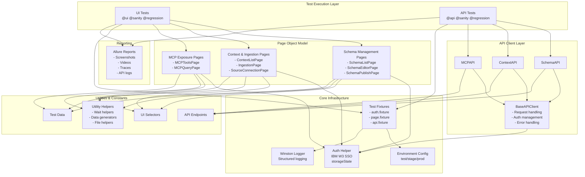
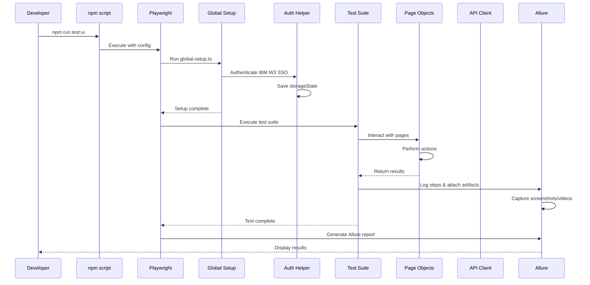
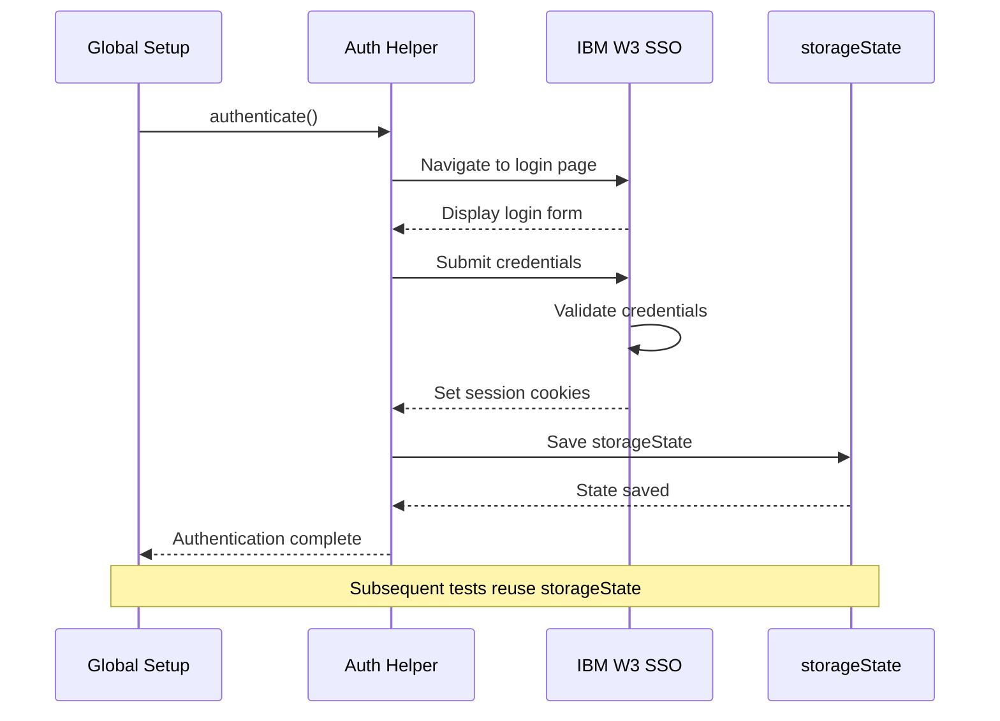

# Context Studio Automation Framework - Architecture

> 📚 **Related Documentation:** [README](README.md) | [Quick Start](QUICK_START.md) | [Contributing](CONTRIBUTING.md) | [Troubleshooting](TROUBLESHOOTING.md)

## 📋 Table of Contents

- [Overview](#overview)
- [Framework Architecture](#framework-architecture)
- [Directory Structure](#directory-structure)
- [Test Execution Flow](#test-execution-flow)
- [Authentication Flow](#authentication-flow)
- [Module Coverage](#module-coverage)
- [Key Features](#key-features)
- [Execution Commands](#execution-commands)
- [Best Practices](#best-practices)
- [Related Resources](#related-resources)

## Overview

Production-grade test automation framework for Context Studio, an IBM enterprise platform for AI agent context management.

**Quick Links:**
- 🚀 [Get Started in 5 Minutes](QUICK_START.md)
- 📖 [Complete Documentation](README.md)
- 🤝 [How to Contribute](CONTRIBUTING.md)
- 🔧 [Troubleshooting Guide](TROUBLESHOOTING.md)
- 📺 [Video Tutorials](docs/VIDEO_TUTORIALS.md)

## Framework Architecture



## Directory Structure

```
context-studio-automation/
├── config/
│   ├── environments/
│   │   ├── test.env
│   │   ├── stage.env
│   │   └── prod.env
│   └── env-loader.ts
├── constants/
│   ├── selectors.ts
│   ├── api-endpoints.ts
│   └── test-data.ts
├── pages/
│   ├── base-page.ts
│   ├── schema/
│   │   ├── schema-list.page.ts
│   │   ├── schema-editor.page.ts
│   │   └── schema-publish.page.ts
│   ├── context/
│   │   ├── context-list.page.ts
│   │   ├── ingestion.page.ts
│   │   └── source-connection.page.ts
│   └── mcp/
│       ├── mcp-tools.page.ts
│       └── mcp-query.page.ts
├── api/
│   ├── base-api.ts
│   ├── schema-api.ts
│   ├── context-api.ts
│   └── mcp-api.ts
├── fixtures/
│   ├── auth.fixture.ts
│   ├── page.fixture.ts
│   └── api.fixture.ts
├── utils/
│   ├── logger.ts
│   ├── auth-helper.ts
│   ├── wait-helpers.ts
│   ├── data-generators.ts
│   └── file-helpers.ts
├── hooks/
│   ├── global-setup.ts
│   └── global-teardown.ts
├── tests/
│   ├── ui/
│   │   ├── schema/
│   │   │   ├── schema-creation.spec.ts
│   │   │   ├── schema-editing.spec.ts
│   │   │   └── schema-publishing.spec.ts
│   │   ├── context/
│   │   │   ├── context-creation.spec.ts
│   │   │   ├── file-ingestion.spec.ts
│   │   │   └── source-connection.spec.ts
│   │   └── mcp/
│   │       ├── mcp-tools.spec.ts
│   │       └── mcp-queries.spec.ts
│   └── api/
│       ├── schema/
│       │   ├── schema-crud.spec.ts
│       │   └── schema-validation.spec.ts
│       ├── context/
│       │   ├── context-crud.spec.ts
│       │   └── ingestion-status.spec.ts
│       └── mcp/
│           ├── mcp-get-contexts.spec.ts
│           ├── mcp-queries.spec.ts
│           └── mcp-post-event.spec.ts
├── test-data/
│   ├── schemas/
│   │   ├── valid-schema.json
│   │   └── invalid-schema.json
│   └── files/
│       ├── sample-document.pdf
│       └── sample-csv.csv
├── reports/
│   ├── allure-results/
│   └── allure-report/
├── .auth/
│   └── user.json (gitignored)
├── package.json
├── tsconfig.json
├── .eslintrc.json
├── .prettierrc
├── playwright.config.ts
├── .gitignore
└── README.md
```

## Test Execution Flow



## Authentication Flow



## Module Coverage

### 1. Schema Management
- **UI Tests**: Create, edit, publish schemas (JSON-LD, CSV, manual)
- **API Tests**: CRUD operations, validation, publishing workflow
- **Components**: Nodes, Edges, Actions, Constraints

### 2. Context & Ingestion
- **UI Tests**: Context creation, file upload, source connections
- **API Tests**: Context CRUD, ingestion status polling, async monitoring
- **Sources**: GitHub, SharePoint, manual file upload

### 3. MCP Exposure
- **UI Tests**: Tool configuration, query execution
- **API Tests**: Get Contexts, Get Metadata, Graph/Vector/Hybrid Query, Post Event
- **Tools**: Context retrieval, querying, event posting

## Key Features

### Environment Management
- Three environments: test (default), stage, prod
- CLI parameter: `--testEnv=stage`
- Environment-specific configurations loaded dynamically

### Tagging Strategy
- `@sanity` - Critical path tests
- `@regression` - Full regression suite
- `@prodsanity` - Production smoke tests
- `@stagsanity` - stage smoke tests
- `@ui` - UI tests only
- `@api` - API tests only
- `@schema` - Schema module tests
- `@context` - Context module tests
- `@mcp` - MCP module tests

### Reporting
- Allure reports with screenshots, videos, traces
- API request/response logging
- Structured Winston logging
- Failure artifacts automatically captured

### Code Quality
- TypeScript strict mode
- ESLint with no-explicit-any enforcement
- Prettier for code formatting
- No page.waitForTimeout allowed

## Execution Commands

```bash
# Run all tests
npm run test:all

# Run UI tests only
npm run test:ui

# Run API tests only
npm run test:api

# Run sanity tests
npm run test:sanity

# Run regression tests
npm run test:regression

# Run specific tags
npm run test:tag -- --grep @schema

# Run in specific environment
npm run test:env -- --testEnv=stage

# Generate and open Allure report
npm run report:generate
npm run report:open
```

## Best Practices

1. **Page Object Model**: All UI interactions through page objects
2. **API Client Layer**: Centralized API request handling
3. **Authentication**: Reuse storageState for performance
4. **Waiting**: Use Playwright auto-waiting, no arbitrary timeouts
5. **Logging**: Structured logging for debugging
6. **Test Data**: Externalized in test-data/ directory
7. **Error Handling**: Comprehensive error handling in API clients
8. **Reporting**: Rich Allure reports with all artifacts
9. **Type Safety**: Full TypeScript typing, no any types
10. **Independence**: Tests can run independently and in parallel

**Learn More:**
- [Contributing Guide](CONTRIBUTING.md#coding-standards) - Detailed coding standards
- [Quick Start](QUICK_START.md) - Get started quickly
- [Troubleshooting](TROUBLESHOOTING.md) - Common issues and solutions

## Related Resources

### Documentation
- **[README.md](README.md)** - Complete framework documentation
- **[QUICK_START.md](QUICK_START.md)** - 5-minute quick start guide
- **[CONTRIBUTING.md](CONTRIBUTING.md)** - Contribution guidelines
- **[TROUBLESHOOTING.md](TROUBLESHOOTING.md)** - Troubleshooting guide
- **[IMPLEMENTATION_PLAN.md](IMPLEMENTATION_PLAN.md)** - Development roadmap and status

### Specialized Guides
- **[Authentication Comparison](docs/AUTHENTICATION_COMPARISON.md)** - Auth pattern analysis
- **[MCP Output Formatting](docs/MCP_OUTPUT_FORMATTING.md)** - MCP tool output formatting
- **[Video Tutorials](docs/VIDEO_TUTORIALS.md)** - Step-by-step video guides

### Code References
- **[UI Selectors](src/constants/selectors.ts)** - Centralized UI selectors
- **[API Endpoints](src/constants/api-endpoints.ts)** - API endpoint definitions
- **[Test Data](src/constants/test-data.ts)** - Test data constants

### Getting Help
- **Slack:** #context-studio-automation
- **GitHub Issues:** Use templates for bugs/features
- **Team Lead:** Contact via IBM internal channels

---

**Framework Status:** 🟢 Production Ready
**Last Updated:** June 2026
**Made with Bob** 🤖